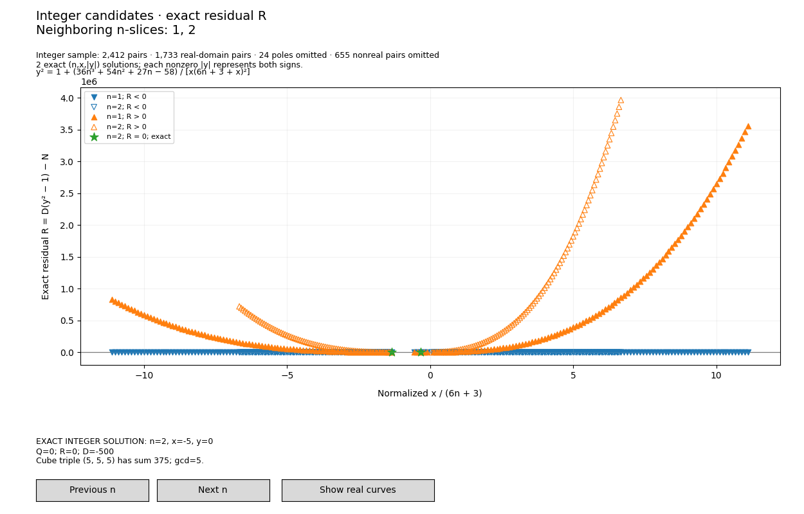
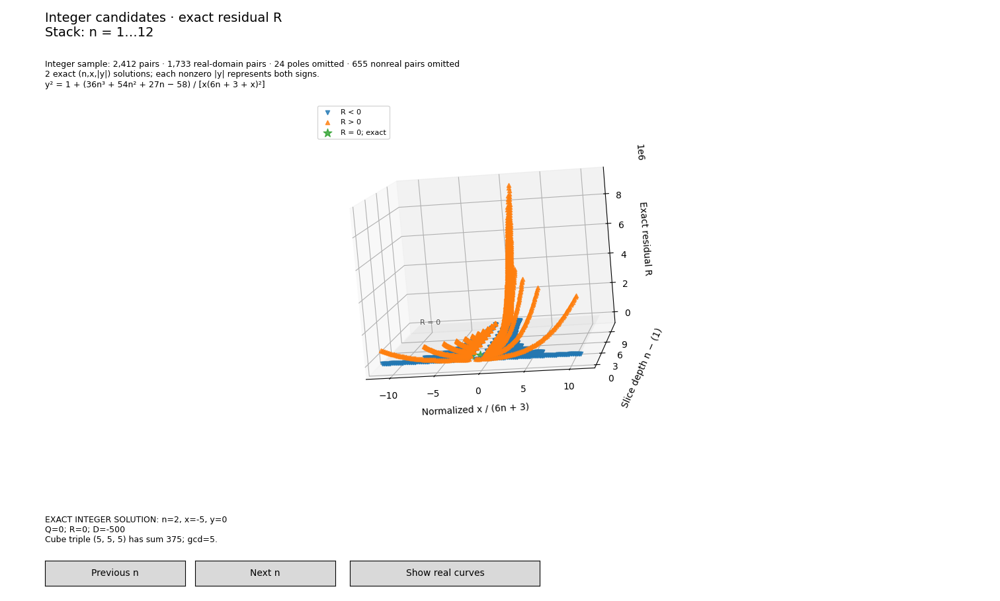

# Experiment #1: Squared Equation Slice Lab

A Python and Matplotlib experiment for visualizing nearby slices of

$$
y^2 = 1 + \frac{36n^3 + 54n^2 + 27n - 58}{x(6n+3+x)^2}.
$$

The denominator is **$x(6n+3+x)^2$**: only the parenthesized factor is squared.

The experiment compares successive integer values of $n$, draws the real branches of the equation, and tests integer candidates using an exact residual. It follows the nearby-slice idea explored in discussions with Jeff Banks. Integer solutions of this equation also give certain integer solutions of $a^3+b^3+c^3=375$.

## Files

| File | Purpose |
| --- | --- |
| [Script](./Script) | Standalone Python explorer; the repository filename has no extension. |
| [squared-equation-2d.png](./squared-equation-2d.png) | Saved residual plot comparing the $n=1$ and $n=2$ slices. |
| [squared-equation-3d.png](./squared-equation-3d.png) | Saved residual plot stacking $n=1,\ldots,12$. |

## Run the experiment

Use Python **3.10 or later**, with Matplotlib and NumPy.

From the root of a local checkout of this repository:

```bash
cd "375/Mathplotlib/Experiment /#1"
python3 -m pip install matplotlib numpy
python3 Script --n 1 --x-min -100 --x-max 100 --slices 12 --mode residual
```

The directory name `Experiment ` contains a trailing space. Copy the quoted path exactly. The executable Python source is named `Script`, so it can be run directly with `python3 Script`.

For the Mac setup used in this experiment, `/usr/local/bin/python3` can be substituted for `python3` in these commands.

The last command opens two linked Matplotlib windows:

- **2D:** the first two slices, $n=1$ and $n=2$.
- **3D:** all twelve slices, $n=1,\ldots,12$.

The integer $x$-range is inclusive. Running `python3 Script` with no options uses these same settings.

## Recorded graphical results

The images below were saved from the residual view with the settings above. The sample totals shown in both windows refer to the full twelve-slice sample, even though the 2D window displays only its first two slices.

| Measurement | Result |
| --- | ---: |
| Integer $(n,x)$ pairs examined | 2,412 |
| Pairs in the real domain | 1,733 |
| Pairs excluded because the denominator is zero | 24 |
| Pairs excluded because $y^2<0$ | 655 |
| Adjacent-integer candidates, with the two signs of $y$ combined | 3,464 |
| Exact integer solutions, with signs combined | 2 |

### 2D: neighboring slices



The horizontal axis is $x/(6n+3)$ and the vertical axis is the residual $R$. Filled triangle markers represent the first slice; outline triangles represent the second. Green stars mark exact integer solutions.

### 3D: stacked slices



The depth coordinate is $n-n_{\mathrm{start}}$, so depth zero represents the starting slice. Height is $R$, and the faint plane marks $R=0$.

Both images show the selected point $(n,x,y)=(2,-5,0)$ in their detail panels. Re-running the command reproduces the sampled data; window size, viewing angle, and the selected point can differ from these saved images.

## How the integer experiment works

Write

$$
S=6n+3,\qquad
N=36n^3+54n^2+27n-58=\frac{S^3-375}{6},
$$

$$
D=x(S+x)^2,\qquad Q=1+\frac{N}{D}.
$$

The equation is $y^2=Q$. For each sampled integer pair $(n,x)$, the program:

1. Excludes $D=0$, namely $x=0$ or $x=-S$.
2. Excludes $Q<0$, where there is no real value of $y$.
3. Finds the integers immediately below and above $\sqrt Q$. If $\sqrt Q$ is already an integer, it keeps that candidate once.
4. Evaluates the exact residual

$$
R=D(y^2-1)-N
=x(6n+3+x)^2(y^2-1)-(36n^3+54n^2+27n-58).
$$

**For a point in the valid domain, $R=0$ means the original equation is satisfied exactly.**

| Marker | Meaning |
| --- | --- |
| Blue downward triangle | $R<0$ |
| Orange upward triangle | $R>0$ |
| Green star | $R=0$: an exact integer solution |

Because $y$ appears squared, each residual dot represents both $+y$ and $-y$; zero has only one sign. A nonzero residual is an integer candidate, not an exact solution. The neighboring candidates suffice to detect an integer root for each tested $(n,x)$ pair.

### Why use the normalized horizontal axis?

Let $u=x/S$. Since $n$ is an integer, $S=6n+3$ is never zero, and

$$
Q=1+\frac{N/S^3}{u(u+1)^2}.
$$

The excluded denominator zeros therefore occur at the same horizontal positions, $u=0$ and $u=-1$, for every slice. This helps compare the geometry as $n$ changes. Use `--axis x` to plot the original $x$ coordinate instead.

### Why do bands and curves appear?

For fixed $n$ and fixed integer $y$, the residual is a polynomial of degree at most three in $x$. It is cubic when $y^2\ne1$:

$$
R=(y^2-1)x(S+x)^2-N.
$$

Many neighboring candidates share the same integer $y$, so they trace portions of these polynomial curves. For example, candidates with $y=\pm1$ all have $R=-N$, producing a horizontal band within a slice. These patterns describe the residual geometry; an exact integer solution still requires $R=0$.

## Two exact points in the recorded sample

For $n=2$, the equation becomes

$$
y^2=1+\frac{500}{x(15+x)^2}.
$$

Both $x=-20$ and $x=-5$ make the denominator $-500$, giving $y^2=0$. Thus the sample contains

$$
(n,x,y)=(2,-20,0),\qquad (2,-5,0).
$$

There is a useful geometric distinction between them. Combining the terms gives

$$
Q=\frac{x(x+15)^2+500}{x(x+15)^2}
=\frac{(x+20)(x+5)^2}{x(x+15)^2}.
$$

The real domain of this slice is

$$
(-\infty,-20]\ \cup\ \{-5\}\ \cup\ (0,\infty).
$$

The point $(-20,0)$ lies at the end of a real branch. The point **$(-5,0)$ is isolated**: nearby $x$-values on either side have $Q<0$. The program explicitly retains that isolated point when drawing real curves.

To inspect the two points using ordinary $x$ coordinates:

```bash
python3 Script --n 2 --x-min -25 --x-max -1 --slices 1 --mode curves --axis x
```

## Connection to the sum of three cubes, $k=375$

For a sampled integer triple $(n,x,y)$, define

$$
a=-x-y(S+x),\qquad
b=-x+y(S+x),\qquad
c=S+2x.
$$

Expanding the cubes gives the identity

$$
a^3+b^3+c^3
=S^3-6x(S+x)^2(y^2-1)
=375-6R.
$$

Consequently, an exact integer point with $R=0$ gives an integer solution of $a^3+b^3+c^3=375$.

| Point $(n,x,y)$ | Corresponding $(a,b,c)$ | Verification | Common divisor |
| --- | --- | --- | ---: |
| $(2,-20,0)$ | $(20,20,-25)$ | $20^3+20^3+(-25)^3=375$ | 5 |
| $(2,-5,0)$ | $(5,5,5)$ | $5^3+5^3+5^3=375$ | 5 |

A primitive cubic solution requires $\gcd(\lvert a\rvert,\lvert b\rvert,\lvert c\rvert)=1$. **Neither of these two cubic triples is primitive.**

The integer-$y$ restriction limits the cubic triples explored by this program. For example, inverting the displayed map requires

$$
y=\frac{b-a}{a+b+2c},
$$

when that denominator is nonzero, and this quotient need not be an integer. A finite search of this parametrization does not establish that all cubic solutions have been examined.

## Interactive controls

| Control | Action |
| --- | --- |
| **Previous n / Next n**, or Left/Right keys | Shift the starting $n$ by one and redraw both windows. |
| **Show real curves / Show residuals** | Switch between actual real $y$-branches and integer-candidate residuals. |
| Click a residual dot or solution star | Inspect exact values and, for an exact solution, its cubic triple. |
| Click a real curve | Inspect an approximate point on the continuous branch. |
| Drag inside the 3D axes | Rotate the view. |
| Matplotlib toolbar | Zoom, pan, or save the displayed figure. |

In real-curve mode, height is $y$, not $R$. The curves are separated at poles and nonreal intervals; isolated real points are retained. Exact integer solutions are overlaid as green stars.

## Further commands

Run these from the experiment folder.

### Draw the positive-$x$ real branches

```bash
python3 Script --mode curves --x-min 1 --x-max 100
```

### Examine a larger window

```bash
python3 Script --n 1000 --x-min 600 --x-max 800 --slices 20 --mode residual
```

This examines $n=1000,\ldots,1019$ and every integer $x=600,\ldots,800$.

### Focus on candidates near zero residual

```bash
python3 Script --residual-limit 1000
```

The filter keeps $|R|\le1000$ in the residual view. To display only exact integer solutions there, use `--solutions-only`.

### Export both plots without opening windows

```bash
python3 Script --save-prefix results/squared-equation
```

This creates `results/squared-equation-2d.png` and `results/squared-equation-3d.png` using the initial view.

### Check the integer sample and export its candidates

```bash
python3 Script --search-only --csv results/candidates.csv
```

The CSV includes exact integers, the numerator and denominator of $Q$, each residual, and an exact-solution flag. It contains **all valid integer candidates in the initial sample**, including those hidden by display filters. Moving through slices in the GUI does not rewrite an already-exported CSV.

For the complete list of options:

```bash
python3 Script --help
```

## Arithmetic and scope

- Integer-domain checks, candidate roots, and residuals use Python integers, `Fraction`, and `isqrt`. Floating-point rounding does not decide whether $R=0$.
- Continuous curves and screen coordinates use floating point. Very large coordinates can merge visually; retain the exact console or CSV values when investigating large samples.
- Each sample is limited to **300,000 $(n,x)$ pairs** and **100 consecutive slices**.
- The results concern the specified finite ranges. Visible bands, apparent intersections, or a sample with no hits do not prove existence or nonexistence elsewhere.
- This is an educational explorer of the stated equation and its restricted integer parametrization of cubic solutions. The implementation and its definitions are in [Script](./Script).
