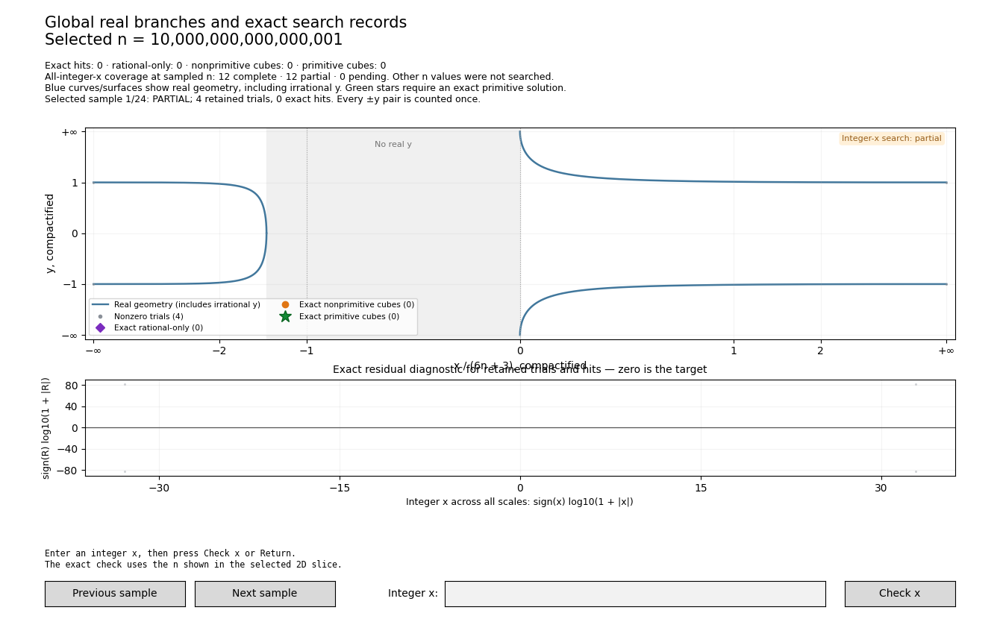
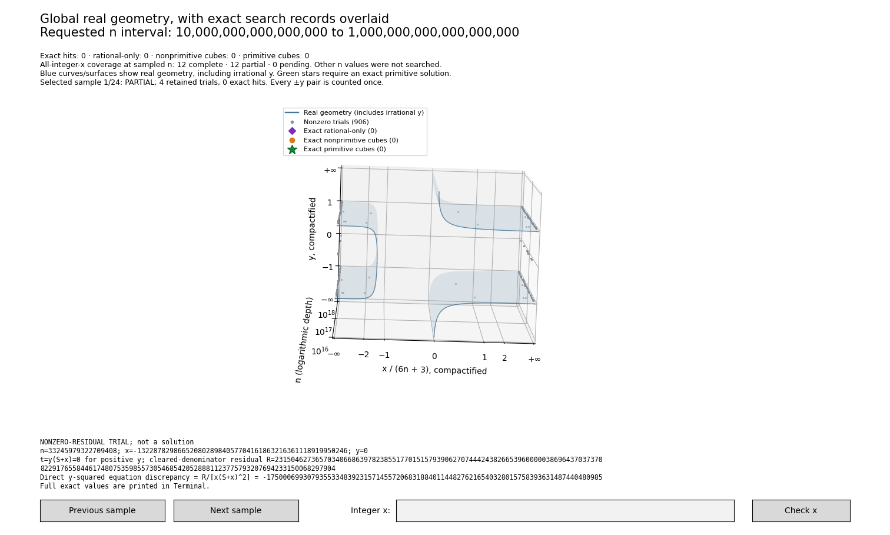

# Experiment #3 — Global rational-y geometry and the search for primitive cube sums of 375

This experiment explores

$$
y^2=1+\frac{36n^3+54n^2+27n-58}{x(6n+3+x)^2},
\qquad n,x\in\mathbb Z,\quad y\in\mathbb Q,
$$

with the broader objective of finding **primitive integer solutions** to

$$
A^3+B^3+C^3=375.
$$

The displayed interval is

$$
10^{16}\le n\le10^{18}.
$$

The global visualization includes both real x-branches and both signs of y. The arithmetic search examines selected integer n-values using an algebraic factor-pair method. A completed slice covers **every integer x** at that fixed n, without an arbitrary x-window. The n interval itself is sampled.

**Result recorded in the attached screenshots:** 24 selected n-values; 12 slices reported complete, 12 partial, and no exact rational points or primitive integer cube solutions found. The green stars in the legends describe the marker type; their count is zero.

## Contents

- [Recorded results and files](#recorded-results-and-files)
- [Reading the 2D and 3D figures](#reading-the-2d-and-3d-figures)
- [Exact arithmetic and the cube-sum connection](#exact-arithmetic-and-the-cube-sum-connection)
- [Modular conditions](#modular-conditions)
- [The global factor-pair search](#the-global-factor-pair-search)
- [Coverage and interpretation](#coverage-and-interpretation)
- [Running the experiment](#running-the-experiment)
- [Provenance and references](#provenance-and-references)

## Recorded results and files

| File | Purpose |
|---|---|
| [Script](./Script) | Standalone Python program for searching and plotting |
| [results/global_branches_2d.png](./results/global_branches_2d.png) | Supplied screenshot of one selected n-slice and its residual panel |
| [results/global_geometry_3d.png](./results/global_geometry_3d.png) | Supplied screenshot of the global real geometry and run-wide records |
| [README.md](./README.md) | Mathematical explanation, interpretation, and run instructions |

The two PNGs preserve the uploaded screenshots byte for byte. They record an interactive run, including its selected slice, camera angle, and footer messages. The pictured buttons are static in the PNGs; their controls operate when the Python program is running.

### Counters visible in these screenshots

| Quantity | Reported value |
|---|---:|
| Requested n interval | 10,000,000,000,000,000 to 1,000,000,000,000,000,000 |
| Selected integer n-values | 24 |
| Complete all-integer-x slices | 12 |
| Partial slices | 12 |
| Pending slices | 0 |
| Nonzero trial records in the 3D legend, across the run | 906 |
| Selected sample | 1 of 24 |
| Selected n in the 2D view | 10,000,000,000,000,001 |
| Status of that selected slice | Partial |
| Nonzero trials retained for that selected slice | 4 |
| Exact rational-only points | 0 |
| Exact nonprimitive integer cube solutions | 0 |
| Exact primitive integer cube solutions | 0 |

These are the counters in **this uploaded run**. Factorization progress can differ between runs because the factor worker has a wall-clock budget. The figures alone do not specify the actual command, package versions, timing, or which twelve individual n-values completed; those details belong in the Terminal log and coverage CSV.

## Reading the 2D and 3D figures

### 2D: one selected n, complete real branches, and exact residuals



The upper panel displays the real curve at the selected n. Blue curves include both rational and irrational values of y. The pale band indicates x-values for which no real y exists. The badge at the top right gives the arithmetic search status for this slice.

The lower panel positions retained arithmetic trials and exact hits using signed logarithmic coordinates:

$$
X_R=\operatorname{sgn}(x)\log_{10}(1+|x|),
\qquad
Y_R=\operatorname{sgn}(R)\log_{10}(1+|R|).
$$

R is the exact cleared-denominator residual defined below. The horizontal line at zero is the target. A trial above or below it has nonzero residual and is not a solution, regardless of how close it looks to a curve at screen resolution.

The selected slice in this screenshot is partial and contains four retained nonzero trials. Its empty exact-solution categories do not settle whether other integer x-values at that n admit rational y.

### 3D: global real geometry across n



| Axis | Meaning |
|---|---|
| Horizontal | Normalized x/(6n+3), compressed to include both infinite tails |
| Depth | n on a logarithmic scale, with ticks at 10^16, 10^17, and 10^18 |
| Vertical | y, compressed to include both signs and their infinite limits |

The translucent surfaces visualize the real equation across the requested interval. The overlaid arithmetic records come from the finitely many selected integer n-values. A continuous surface between slices does not mean that every intervening integer n has been searched.

The 3D legend counts records across all slices, which is why its **906 nonzero trials** differs from the **four trials** in the selected 2D slice. A ±y pair is counted once even though both signs are drawn; a zero-y record has one plotted sign. Exact-hit counts identify (n,x,|y|) records, not necessarily distinct cube triples up to every permutation.

### Why the 3D footer shows a different n

The screenshot's footer describes a clicked trial at

$$
n=33{,}245{,}979{,}322{,}709{,}408,
\qquad y=0.
$$

Clicking a point updates the detail text; it does not change the selected n-slice. Thus this footer can coexist with the header's selected sample 1 of 24.

The footer explicitly reports a **nonzero-residual trial**. Its y=0 is a tested value, not a verified equation point. Grey records are retained arithmetic trials and need not be close to the real curve.

### Marker meanings

| Marker | Exact interpretation |
|---|---|
| Blue line or surface | Real geometry, including irrational y |
| Grey dot | A trial with nonzero residual; not an equation solution |
| Purple diamond | Exact rational y, with cube coordinates that are not all integers |
| Orange circle | Exact integer cube solution with gcd 5; nonprimitive |
| **Green star** | Exact integer cube solution with sum 375 and gcd 1; primitive |

The program rechecks the original rational equation and the cube-sum conditions before drawing an exact solution marker. A marker's appearance is determined by exact arithmetic, not floating-point proximity.

### Why infinity fits on the axes

Put u=x/(6n+3). The displayed coordinates are

$$
q=\frac{2}{\pi}\arctan(u),
\qquad
v=\frac{2}{\pi}\arctan(y).
$$

Each unbounded axis is mapped into (-1,1). The tick labels show the original u and y values. The endpoints labelled infinity represent limits, not additional finite integer solutions. Extremely large finite coordinates can become visually indistinguishable from those endpoints; Terminal output and CSV records retain the full integers and fractions.

### Why the surfaces look almost unchanged across n

Set S=6n+3. The normalized equation is

$$
y^2=1+\frac{1-375/S^3}{6u(1+u)^2}.
$$

At the requested scale, the correction 375/S^3 is roughly 1.7×10^-48 at the lower end and 1.7×10^-54 at the upper end. Consequently, the normalized real curves are visually almost identical. The differences in arithmetic behaviour arise from exact integers, factorization, and square conditions that the smooth geometry cannot reveal by itself.

For n≥3, the real domain consists of x>0 and an outer negative branch x≤x_-(n)<-4S/3, where

$$
x_-(S+x_-)^2+N=0.
$$

The normalized negative endpoint approaches u≈-1.35120719196. Both tails approach y=±1; the positive branch has |y|→∞ as x→0 from above. The original equation is undefined at x=0 and x=-S.

## Exact arithmetic and the cube-sum connection

Define

$$
S=6n+3,\qquad T=S+x,
$$

$$
N=36n^3+54n^2+27n-58=\frac{S^3-375}{6}.
$$

The equation becomes

$$
y^2=1+\frac{N}{xT^2}.
$$

All statements here exclude the poles x=0 and T=0.

### An exact rational-y test at a chosen integer x

Multiplying by x²T² gives

$$
(yxT)^2=x^2T^2+xN.
$$

The right-hand side is an integer. A rational number whose square is an integer must itself be an integer. Therefore rational y exists exactly when

$$
H=x^2T^2+xN
$$

is a nonnegative perfect square. If H=r², then

$$
y=\pm\frac{r}{|xT|}.
$$

The program uses integer square roots and exact fractions for this check. A negative H gives no real y. When H is nonnegative but not square, a nearby square-root trial may be retained as a grey diagnostic point; it is not accepted as a solution.

### From rational y to three cubes

Let t=yT and define

$$
A=-x-t,\qquad B=-x+t,\qquad C=S+2x.
$$

Define the cleared-denominator residual

$$
R=x(t^2-T^2)-N.
$$

Expanding the cube sum gives

$$
A^3+B^3+C^3=S^3-6x(t^2-T^2)=375-6R.
$$

Thus R=0 is the exact target. An exact rational-y point yields rational cube coordinates with sum 375. To obtain an **integer** cube solution, t must be an integer. At an exact rational point this is equivalent to x dividing N: then t²=T²+N/x is an integer, and rational t is consequently integral.

The lift is **primitive** when

$$
\gcd(A,B,C)=1.
$$

For an integer cube triple with sum 375, its gcd g satisfies g³|375. The only possibilities are g=1 and g=5, explaining the green and orange categories. Changing the sign of y exchanges A and B and leaves C fixed.

### What the residual measures

R is not the raw difference between the two sides of the displayed y² equation. That direct difference is

$$
y^2-1-\frac{N}{xT^2}=\frac{R}{xT^2}.
$$

The distinction matters at large coordinates: the denominator can be enormous. The exact acceptance criterion remains R=0. Neither a tiny normalized discrepancy nor apparent agreement in a plot is enough.

## Modular conditions

Necessary conditions for integer cube lifts to 375 are

$$
n\equiv2\text{ or }5\pmod9,\qquad
x\equiv1\pmod3,\qquad
t\equiv0\pmod3.
$$

They apply to both primitive and nonprimitive integer lifts. They are not requirements for every rational-only point.

Here is a derivation. Cubes modulo 9 are 0 and ±1, and 375≡-3 mod 9. Each of A,B,C must therefore be congruent to -1 modulo 3. Substituting the lift gives x≡1 mod 3 and t≡0 mod 3. Under those residues,

$$
R\equiv-3(n+1)\pmod9,
$$

so an exact lift requires n=2+3k. Writing t=3w and expanding once more gives

$$
R\equiv9(w^2-k)\pmod{27}.
$$

Since squares modulo 3 are 0 and 1, k≡0 or 1 mod 3, hence n≡2 or 5 mod 9. More precisely, n≡2 mod 9 requires t≡0 mod 9; n≡5 mod 9 requires t≡3 or 6 mod 9.

The default sampler chooses n from these admissible classes to focus on the integer-cube goal. It constructs the nominal logarithmic samples with integer arithmetic and adjusts them within the requested interval. This explains the selected first sample 10^16+1. An explicit `--n` checks the supplied n unchanged. `--all-residues` removes the modular restriction from the sampled n-values, allowing rational-only exploration in other classes.

## The global factor-pair search

The earlier local experiment examined narrow x-windows. This version replaces that cutoff with a finite algebraic enumeration at each selected n.

### 1. Decompose the integer x

Write uniquely

$$
x=\sigma s a^2,
\qquad \sigma\in\{-1,1\},\quad a\ge1,
$$

where s is a positive squarefree integer. Let c=a|t|. At a rational point,

$$
c^2=a^2T^2+\frac{\sigma N}{s}.
$$

The reduced denominator on the right divides the squarefree integer s, while the reduced denominator of a rational square is a square. Therefore that denominator must be 1: **s divides N, and c is an integer**.

This reduces the search to squarefree divisors of N and positive factor pairs of N/s.

### 2. Positive x

For x=sa², T>0 and

$$
(c-aT)(c+aT)=N/s.
$$

Let d≤e be the positive factors, with de=N/s. They must have the same parity. Then

$$
sa^3+Sa=\frac{e-d}{2},\qquad c=\frac{e+d}{2}.
$$

The cubic on the left is strictly increasing for a≥1. Exact integer bracketing determines whether it has an integer root.

### 3. The negative real branch

For n≥3, all negative real points lie beyond x=-S. Put x=-sa² with a>√(S/s). Then

$$
(a|T|-c)(a|T|+c)=N/s,
$$

giving

$$
sa^3-Sa=\frac{e+d}{2},\qquad c=\frac{e-d}{2}.
$$

This cubic is strictly increasing on the relevant domain. A successful exact root gives

$$
|y|=\frac{c}{a|S+x|}.
$$

Every resulting candidate is checked against the original rational equation. Adjacent integer a-values can supply nonzero trials for visualization, but trial records do not count as exact points.

### 4. When a slice is complete

A slice is marked complete only when:

1. N has a complete prime factorization with every prime factor proved.
2. Every required squarefree-divisor and factor-pair case has been enumerated.
3. The search has not stopped at an enumeration limit or encountered an error that invalidates completeness.

SymPy discovers factors. When installed, python-flint supplies proven primality through `fmpz.is_prime()`. The fallback uses deterministic small-integer tests and Pocklington certificates where obtainable. A large unproved probable prime does not justify a complete status. See the dependency references below.

Partial factorizations can still produce valid candidates: proved prime factors supply squarefree choices, and unresolved factors can be used as whole divisor blocks. Such a search covers a subset and remains partial. Exact hits found in a partial slice are still valid after substitution.

### Why an unbounded real curve permits a finite exact search

For fixed positive n, integer x-values admitting rational y satisfy finite bounds. With p=|x|, necessary inequalities are

$$
x>0:\quad4p(S+p)^2\le(N-1)^2,
$$

$$
x<0:\quad4p(S-p)^2\le(N+1)^2.
$$

The outer bound grows approximately as 18^(2/3)n², reaching about 6.87×10^36 at n=10^18. The factor-pair method avoids scanning each integer up to this scale. The coverage CSV records the exact integer bounds calculated by the program.

## Coverage and interpretation

The word **global** refers to the displayed real geometry and to all-integer-x coverage of each completed slice. It does not mean that all n in the requested interval have been tested.

The interval contains

$$
10^{18}-10^{16}+1=990{,}000{,}000{,}000{,}000{,}001
$$

integer n-values. This run selects 24 of them. Under the program's completeness conditions, a completed slice with zero exact hits excludes rational y at every integer x for that fixed n. A partial slice with zero hits remains unresolved. Unselected n-values are unsearched.

The supplied screenshots report 12 complete slices, but do not identify each completed n or expose its factorization and enumeration record. They document the program's reported result; a full audit of individual coverage claims requires the companion CSV and log.

The 906 nonzero trial records are retained diagnostics. They are not a count of all x-values, all factor pairs, or all arithmetic operations tested. Trial display limits do not remove exact hits from the result set. Increasing n-sample count or factorization time can expand coverage, but has no guaranteed relationship to finding a primitive solution.

## Running the experiment

### Install dependencies and launch

The repository file is named `Script` and can be executed directly by Python without a `.py` extension. From a local checkout of this repository:

```bash
cd '375/Mathplotlib/Experiment /#3'
python3 -m pip install matplotlib numpy sympy python-flint
python3 Script
```

The quotes preserve the space after `Experiment` and the literal `#` in the directory name. If saving the source separately as `rational_y_global_lab.py` on the Mac used for this experiment:

```bash
cd ~/Downloads
/usr/local/bin/python3 rational_y_global_lab.py
```

Run the program as a file from Terminal so its factor worker can start correctly. The search prints progress before opening the two Matplotlib windows.

### Defaults in the committed source

| Option | Default or behaviour |
|---|---|
| `--n-min` | 10000000000000000 |
| `--n-max` | 1000000000000000000 |
| `--slices` | 24 selected samples; allowed range 1–128 |
| `--spacing` | `log`; `linear` is also available |
| n residue selection | n≡2 or 5 mod 9, unless `--all-residues` is supplied |
| `--factor-seconds` | 3 seconds per n for factorization and prime certification |
| `--backend` | `auto`: SymPy discovery, with FLINT primality when available |
| `--max-pairs` | 200000 factor pairs per n |
| `--max-trials` | Up to 60 retained nonzero trials per n; every exact hit is retained |
| Minimum n for this plotting interface | 3 |

The source also limits divisor generation to guard against very large enumerations; stopping at that limit marks the slice partial. The factorization budget is not a bound on total execution time because enumeration, imports, and drawing also take time.

These are source defaults, not a reconstruction of the exact command used for the screenshots. Changing time budgets, backend availability, package versions, and machine speed can change which slices finish.

### Useful commands

Display the real geometry immediately, without arithmetic searching:

```bash
python3 Script --geometry-only
```

Increase the number of selected n-values and the factorization budget:

```bash
python3 Script --slices 48 --factor-seconds 15
```

Give one selected large n more time:

```bash
python3 Script --n 10000000000000001 --factor-seconds 30 --verbose
```

Sample all residue classes, including those relevant only to rational-y points:

```bash
python3 Script --all-residues
```

Save fresh PNGs and exact CSV data without opening windows:

```bash
python3 Script --save-prefix results/new_global375 --csv results/new_global375_points.csv
```

This writes `new_global375-2d.png`, `new_global375-3d.png`, `new_global375_points.csv`, and `new_global375_points-coverage.csv`. The `new_` prefix keeps fresh outputs separate from the uploaded screenshots documented here.

Run arithmetic only:

```bash
python3 Script --search-only --csv results/new_global375_points.csv
```

### Interactive controls

- **Previous sample / Next sample**, or Left/Right arrow keys, changes the selected n-slice.
- **Click a point** to inspect its exact integers, fractions, residual, and cube coordinates in Terminal. Picking a 3D point updates the footer without changing the selected slice.
- **Integer x / Check x** performs the exact square test at the currently selected n. Enter an integer in decimal form; a manual check does not change the overall coverage status of its slice.
- Use Matplotlib's navigation controls to inspect the figures; the 3D view can be rotated.

With `--csv` in an interactive run, close the windows normally to refresh the CSV files with any manual x checks.

### A small exact control

```bash
python3 Script --n 13
```

This gives

$$
x=-144,\qquad y=\pm\frac{695}{756}.
$$

For positive y, t=-695/12 and the associated cube coordinates are

$$
(A,B,C)=\left(\frac{2423}{12},\frac{1033}{12},-207\right).
$$

Their cube sum is 375, but they are not all integers. The point therefore appears as a purple rational-only marker. This is a separate small-n example, not a hit in the uploaded large-n run.

## Provenance and references

The existing source file reviewed for this documentation is [Script](./Script), Git blob `2956c5a7dd12bfdc2d02e5ed745c0de0276fb7e0`. The image-and-README addition leaves that source unchanged.

The screenshots are the uploaded PNGs, preserved without cropping, redrawing, or regenerating them. Their SHA-256 checksums are:

| Image | SHA-256 |
|---|---|
| `results/global_branches_2d.png` | `36d2633a12273809c447c0e8b5b1a3cc569bced2ec7b68138564702681a2ffec` |
| `results/global_geometry_3d.png` | `1da2252274103235d6ae77a7e9709967168f72f6c223c1b86fc141f181edf41f` |

For a reproducible research record, save the exact command, package versions, Terminal log, point CSV, and coverage CSV from the same run. The coverage CSV records each sampled n, completion flags, factor-pair counts, factorization, unresolved factors, and exact x bounds. Such run files are not reconstructed from the screenshots here.

This experiment uses an algebraic divisor/factor-pair search for the displayed rational-y equation. Huisman's work and the Elsenhans–Jahnel search provide background for the broader sums-of-three-cubes investigation; this implementation should be identified by its actual factor-pair method rather than described as a reproduction of their original lattice algorithm.

Primary references:

1. Sander G. Huisman, [*Newer sums of three cubes*](https://arxiv.org/abs/1604.07746), 2016 — background on computational searches for sums of three cubes.
2. [SymPy number theory documentation](https://docs.sympy.org/latest/modules/ntheory.html) — factorization and primality interfaces used by the search.
3. [python-flint integer API](https://python-flint.readthedocs.io/en/latest/fmpz.html) — the optional integer primality backend.
4. [FLINT `fmpz_is_prime` documentation](https://flintlib.org/doc/fmpz/fmpz_is_prime.html) — proven primality, as distinct from a probable-prime test.
5. [Matplotlib documentation](https://matplotlib.org/stable/) — plotting and interactive controls.

