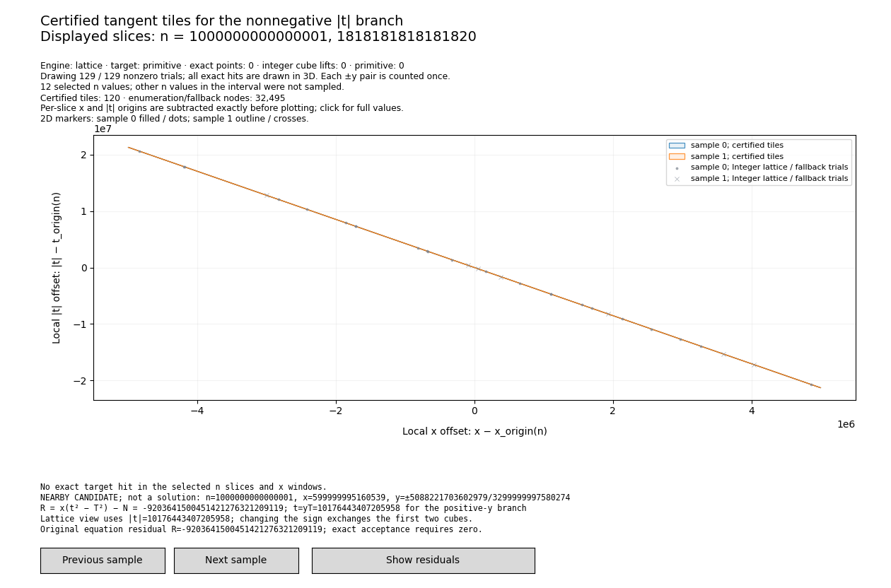
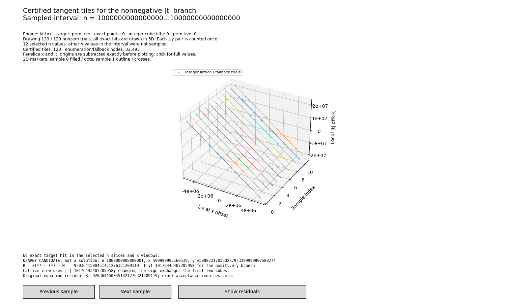

# Experiment 2: Rational-y lattice slices for k = 375

This experiment visualizes a lattice search for primitive integer solutions of

$$
a^3+b^3+c^3=375
$$

through the equation

$$
y^2=1+\frac{36n^3+54n^2+27n-58}{x(6n+3+x)^2},
\qquad n,x\in\mathbb Z,\quad y\in\mathbb Q.
$$

The recorded run selects twelve integer n-values across **10^15 <= n <= 10^16**, with a finite integer x-window for each selected slice. It uses exact arithmetic, necessary modular conditions, certified tangent strips and two-dimensional lattice-basis reduction.

> **Recorded result:** 120 certified tangent tiles, 129 retained candidates with nonzero residual, and **no exact primitive solution in the selected windows**. This is a sampled overview. The intervening n-values and other x-regions were not exhaustively searched.

## Graphical results

These are the original PNGs exported from the interactive Matplotlib run. They show the **tangent-tile view**, rather than the residual view. The pictured controls are interactive only when the Python application is running.

### 2D: two sampled slices



The two displayed slices are:

- Sample 0: n = 1000000000000001.
- Sample 1: n = 1818181818181820.

The blue and orange strips almost overlap at this scale. Their grey dots and crosses are retained integer candidates, not exact solutions.

### 3D: twelve stacked slices



The depth axis is **sample index 0 through 11**, not the numerical value of n. The exact n corresponding to each index is listed below. The extra display axis does not change the search into a three-dimensional lattice algorithm: each fixed-n search uses a two-dimensional lattice in (x,t).

## Files

| File | Purpose |
| --- | --- |
| [Script](Script) | Standalone Python program, stored here without a `.py` extension |
| [2D PNG](results/lattice_tiles_2d.png) | Original two-slice plot |
| [3D PNG](results/lattice_tiles_3d.png) | Original twelve-slice plot |

## Reproduce the experiment

The program requires **Python 3.10 or later**. Interactive plotting uses **Matplotlib and NumPy**; `--search-only` uses Python's standard library.

From this directory, install plotting dependencies if needed:

```bash
python3 -m pip install matplotlib numpy
```

Run the configuration shown in the images:

```bash
python3 Script --preset large
```

If navigating from the repository root, preserve the spaces in the directory names:

```bash
cd '375/Matplotlib/Experiment /#2 '
```

The file does not need a `.py` extension when passed directly to Python. The equivalent command used with a downloaded copy named `rational_y_lab.py` is:

```bash
/usr/local/bin/python3 ~/Downloads/rational_y_lab.py --preset large
```

### Useful views and exports

Open the same experiment directly in residual mode:

```bash
python3 Script --preset large --mode residual
```

Export the retained candidates and an exact record of the searched windows:

```bash
python3 Script --preset large --mode residual --csv large_n_results.csv
```

This writes `large_n_results.csv` and `large_n_results-windows.csv`. The second file records coverage even when no exact hit is found.

Generate fresh PNGs without opening windows:

```bash
python3 Script --preset large --save-prefix large_n_tiles
```

This writes `large_n_tiles-2d.png` and `large_n_tiles-3d.png`. Layout can vary with the Matplotlib version, window size and viewing angle; the checked-in images are the original attached exports.

For a numerical run without plotting:

```bash
python3 Script --preset large --search-only
```

### Interactive controls

- **Previous sample / Next sample:** change the adjacent samples displayed in 2D while retaining the full 3D overview and the existing search results.
- **View button:** cycle through tangent tiles, residuals and rational-y candidate points.
- **Click a point:** print its exact fraction, integer parameters and residual in Terminal.
- **Click a tile:** print its exact enclosure and reduced lattice basis.
- **Drag the 3D axes:** rotate the view. Use the Matplotlib toolbar to zoom or save.

Close both plot windows to finish the interactive run and return to the terminal prompt.

## Search configuration and recorded counts

| Parameter | Recorded value |
| --- | --- |
| Requested n-interval | 1000000000000000 to 10000000000000000, inclusive |
| Selected n-slices | 12 |
| Engine / target | `lattice` / `primitive` |
| x-centre ratio | 1/10 |
| x half-width | 5,000,000 |
| Initial integer-x tile width | 1,000,000 |
| Plot coordinates / initial view | `offset` / `tiles` |
| Integer (n,x) pairs in the selected windows | 120,000,012 |
| Certified tangent tiles | 120 |
| Enumeration/fallback nodes | 32,495 |
| Candidates rejected by the subsequent modular sieve | 18,461 |
| Retained trial records | 129 |
| Exact primitive hits | **0** |

For each selected n, the centre and inclusive x-window are

$$
x_c(n)=\left\lfloor\frac{6n+3}{10}\right\rfloor,
\qquad
x_c(n)-5{,}000{,}000\le x\le x_c(n)+5{,}000{,}000.
$$

Each band contains 10,000,001 integer x-values, so the twelve bands contain 120,000,012 integer pairs. The lattice engine covers the selected bands through certified enclosures and exact verification; this count is **not** the number of explicit lattice enumeration operations.

The n-samples are generated by exact integer interpolation over the requested interval, then moved to the nearest admissible n congruent to 2 or 5 modulo 9 within the bounds. Ties prefer the lower value; duplicates, if any, are removed.

| Sample index | Exact n |
| ---: | ---: |
| 0 | 1000000000000001 |
| 1 | 1818181818181820 |
| 2 | 2636363636363633 |
| 3 | 3454545454545452 |
| 4 | 4272727272727271 |
| 5 | 5090909090909090 |
| 6 | 5909090909090909 |
| 7 | 6727272727272728 |
| 8 | 7545454545454544 |
| 9 | 8363636363636363 |
| 10 | 9181818181818182 |
| 11 | 9999999999999995 |

The full requested n-interval contains 9,000,000,000,000,001 integers. The results here concern only the selected n-values and their specified x-bands. This primitive-target run also does not establish the absence of rational-only points in those bands.

## Reading the axes

Write

$$
S=6n+3,\qquad T=S+x,\qquad
N=36n^3+54n^2+27n-58=\frac{S^3-375}{6},
\qquad t=yT.
$$

The tile view uses the nonnegative absolute-t branch of

$$
t^2=(S+x)^2+\frac Nx.
$$

For the positive-x windows in this experiment, the local origins are

$$
x_c=\left\lfloor\frac S{10}\right\rfloor,
\qquad
t_c(n)=\left\lfloor\sqrt{(S+x_c)^2+\frac N{x_c}}\right\rfloor.
$$

The plotted coordinates are **x - x_c(n)** horizontally and **|t| - t_c(n)** vertically. The 3D view adds the sample index. Each slice has its own origins, which are subtracted exactly before conversion to plotting decimals. The plots therefore compare local geometry around different large absolute coordinates.

At this scale the short tangent strips appear almost straight. Normalizing with u = x/S gives

$$
y^2=1+\frac{1-375/S^3}{6u(1+u)^2}.
$$

Across the requested interval, 375/S^3 is approximately 1.74e-45 to 1.74e-48. This explains why the normalized real curves almost coincide. Exact solution tests still retain the full integer arithmetic.

## Rational candidates, exact rational points and integer cubes

The equation is defined only when **x != 0** and **T != 0**.

### All rational y: an exact square test

Define

$$
H=x^2T^2+xN.
$$

Then

$$
y^2=\frac H{x^2T^2}.
$$

Thus y is rational exactly when H is a nonnegative integer square. If H = r^2, then

$$
y=\pm\frac r{|xT|}.
$$

The `scan --target rational` engine uses this criterion with integer square roots and safe square-residue filters. It needs no arbitrary bound on the denominator of y.

### Integer cube coordinates need an additional condition

For an exact rational point, require **t = yT to be an integer**. This is equivalent to x dividing N at such a point. Reconstruct

$$
a=-x-t,\qquad b=-x+t,\qquad c=S+2x.
$$

Define the **cleared-denominator residual**

$$
R=x(t^2-T^2)-N.
$$

The exact identity is

$$
a^3+b^3+c^3=375-6R.
$$

A primitive hit therefore requires **R = 0**, integer cube coordinates, and **gcd(|a|,|b|,|c|) = 1**. At an exact integer solution, the only possible common divisors are 1 and 5, because a common divisor g must satisfy g^3 dividing 375.

A rational candidate t/T is not automatically a rational solution of the equation. All 129 retained records in this run have nonzero R. The screenshot's phrase "Original equation residual R" refers to the cleared-denominator quantity above; the direct discrepancy in the displayed y-squared equation is

$$
y^2-\left(1+\frac N{xT^2}\right)=\frac R{xT^2}.
$$

Consequently, a point can look extremely close to the curve while its integer residual remains nonzero. Visual proximity never replaces the exact zero test. Changing the sign of t exchanges a and b, so each pair of signs is stored once.

## Necessary modular conditions

For **integer cube lifts**, the necessary conditions include

$$
n\equiv2\text{ or }5\pmod9,
\qquad x\equiv1\pmod3,
\qquad t\equiv0\pmod3.
$$

More precisely, n = 2 modulo 9 requires t = 0 modulo 9, while n = 5 modulo 9 requires t = 3 or 6 modulo 9. These are necessary conditions; passing them does not establish a solution.

The implementation also uses projected conditions modulo 8, 5, 7, 13 and 19, obtained by testing whether a square residue q can satisfy

$$
xq\equiv x(S+x)^2+N\pmod m.
$$

This avoids invalid division by a noninvertible x modulo m. For primitive targets, if 5 divides both S and x, a further necessary condition is v_5(x) = v_5(N), where v_5 is the exponent of 5 in an integer. Divisibility by 5 alone is not a reason to discard every such x.

The lattice engine may retain nonzero trials that fail later exact conditions, including x dividing N, so they can be inspected visually. Integer-cube restrictions on n are not applied to the all-rational scan mode.

## Relation to Huisman, Elsenhans-Jahnel and Elkies

The geometric idea is to enclose short curve segments in thin tangent-aligned regions, reduce a lattice basis to fit those regions, and enumerate integer candidates efficiently. This program adapts that idea to each fixed-n curve

$$
|t|=\sqrt{(S+x)^2+N/x}.
$$

Rational interval and curvature bounds certify the tangent enclosures. Exact two-dimensional Gauss reduction is applied to the affine sublattice

$$
(x,t)=(1,0)+u(3,0)+v(0,3),\qquad u,v\in\mathbb Z.
$$

Candidates are then verified using the exact residual and primitive criterion. Unsuitable intervals are subdivided or handled by an exact local fallback. A work-limit failure is reported explicitly and is not described as a complete search.

This is a **fixed-n, two-dimensional adaptation** of the geometric method. The original global Elsenhans-Jahnel implementation uses a three-dimensional lattice formulation with LLL and Fincke-Pohst enumeration. The 3D figure here is a visualization of stacked two-dimensional searches, and the sampled n-range is not a global bound on all cube coordinates.

Primary references:

- [Sander G. Huisman, *Newer sums of three cubes* (2016), section 2](https://arxiv.org/pdf/1604.07746).
- [Andreas-Stephan Elsenhans and Jorg Jahnel, *New sums of three cubes*](https://wwwuser.gwdguser.de/~jjahnel/Arbeiten/elk_ants6c.pdf).
- [Noam D. Elkies, lattice reduction for rational points near curves (arXiv:math/0005139)](https://arxiv.org/pdf/math/0005139).

## Further local experiments

Use 24 sampled n-values and open in residual mode:

```bash
python3 Script --preset large --slices 24 --mode residual
```

Inspect twelve consecutive n-values beginning at 5e15:

```bash
python3 Script --preset local-large --n 5000000000000000 --mode residual
```

Search for all rational y at sampled integer pairs:

```bash
python3 Script --preset large --engine scan --target rational --mode residual
```

The last command uses the smaller direct-scan default x half-width of 5,000 and does not snap n-samples to the integer-cube residue classes. It is a different experiment from the primitive-target run pictured above.

Use `--n` and `--n-stop` to choose another sampled interval, `--slices` to choose the sample count, and `--x-center-ratio` / `--x-half-width` to choose the per-slice x-bands. `--help` lists the available settings. Every reported result remains scoped to its explicitly selected windows.
