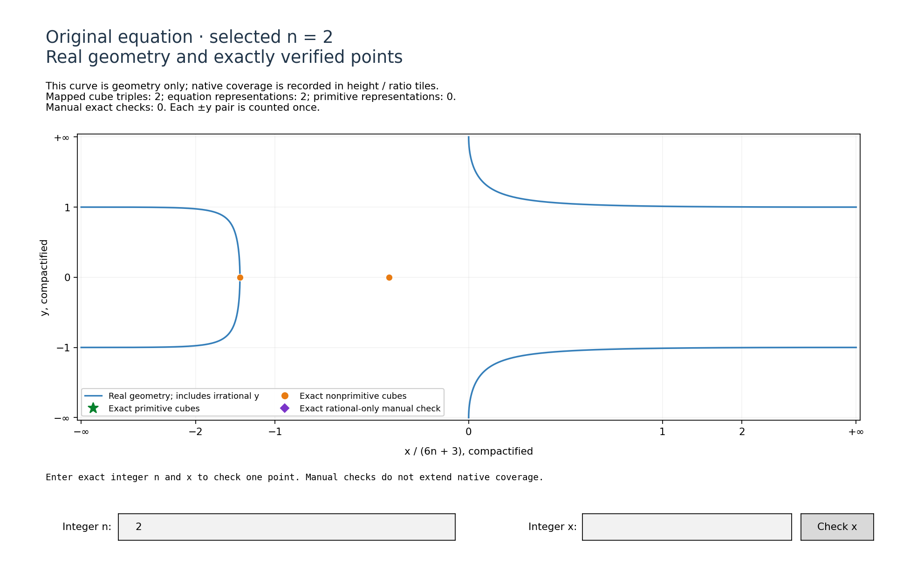
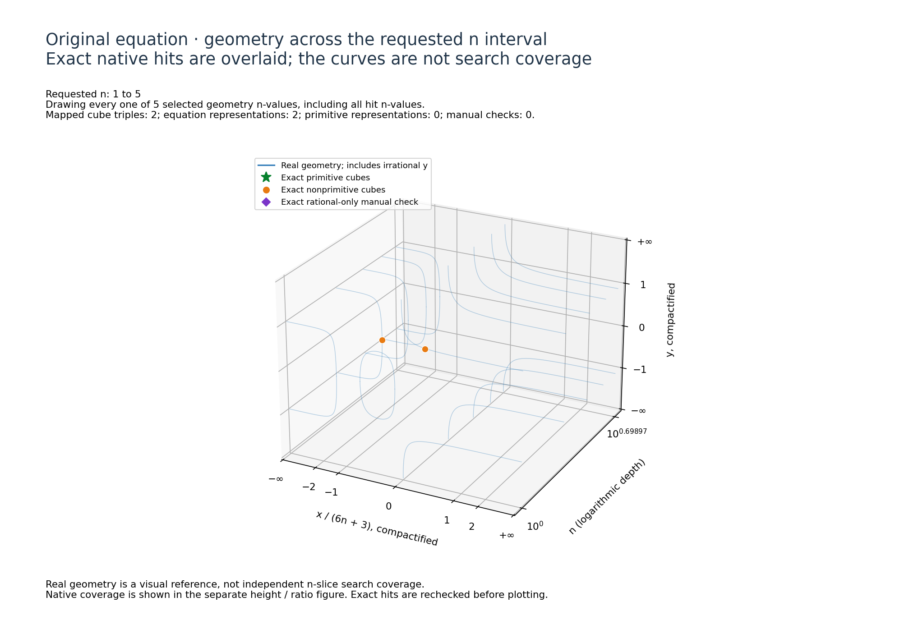
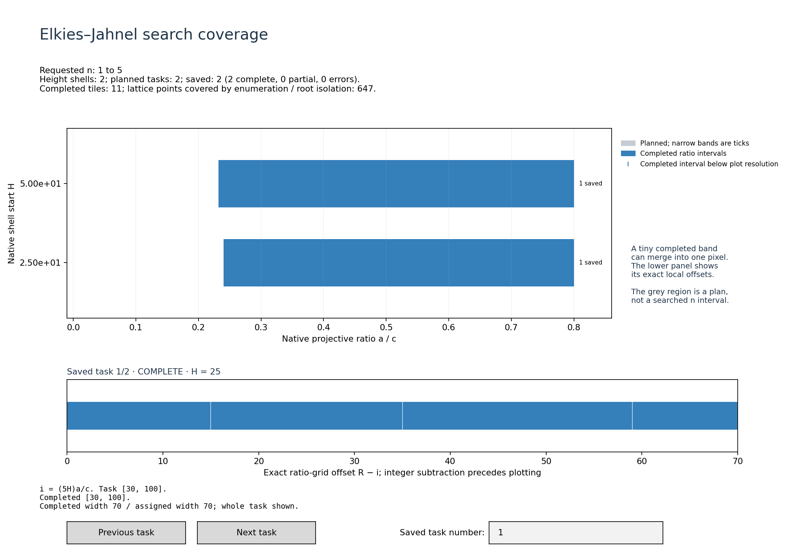

# Complete small integer-cube control

Command:

```bash
python3 elkies375_lab.py --preset demo --out examples/demo --save-prefix examples/demo/demo
```

Scope: every integer cube lift of the equation for `1 <= n <= 5`, with all
derived coordinate heights included. The native plan has two height/ratio
tasks. Both completed: **11 tiles and 647 lattice points** were covered by
enumeration/root isolation. The separate height-below-25 check enumerated
1,225 ordered coordinate pairs. Its exact cube lookup recovers the remaining
small triple.

The complete result consists of:

| n | x | y | Canonical cube triple up to permutation | gcd |
|---:|---:|---:|---|---:|
| 2 | -5 | 0 | (5, 5, 5) | 5 |
| 2 | -20 | 0 | (20, 20, -25) | 5 |

These are orange nonprimitive markers. There are **no primitive green-star
solutions in this complete small integer-cube scope**. This result is not a
classification of every rational-only y in the same n interval.

The `(20,20,-25)` example lies at native height 25 and ratio `a/c = 4/5`,
so it also checks the included upper ratio boundary. The `(5,5,5)` example
shows why a native height-25 search needs the separate small-height check.







See [summary.json](summary.json), [points.csv](points.csv),
[coverage.csv](coverage.csv), [low_height.json](low_height.json), and
[run.log](run.log) for the exact results and execution record.

Reopen these saved results without compiling or searching:

```bash
python3 elkies375_lab.py --plot-only examples/demo
```
