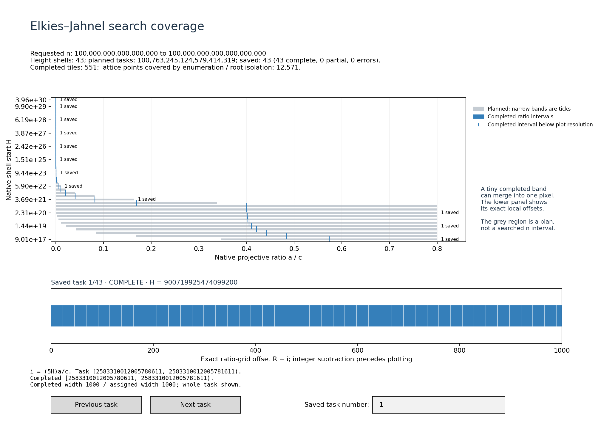
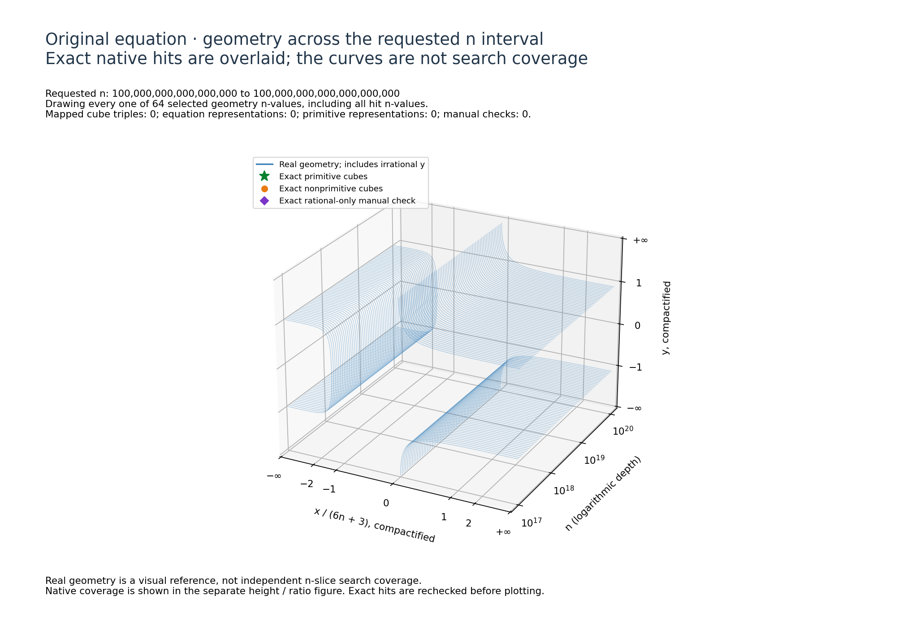
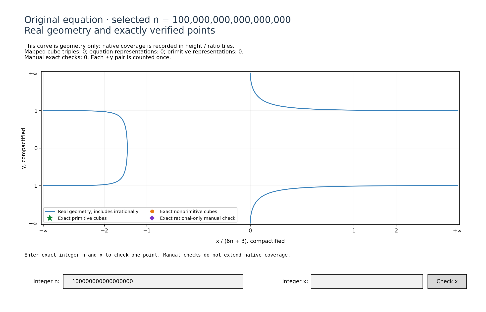

# Actual large-range Elkies pilot

This is a **bounded pilot**, with actual native work in every planned height
shell. It does not complete the requested n interval.

Command:

```bash
python3 elkies375_lab.py \
  --n-min 100000000000000000 \
  --n-max 100000000000000000000 \
  --target primitive \
  --max-tasks 43 \
  --max-tiles 64 \
  --geometry-slices 64 \
  --out examples/large-pilot \
  --save-prefix examples/large-pilot/large
```

## What was actually searched

| Quantity | Recorded value |
|---|---:|
| Requested inclusive n interval | 10^17 through 10^20 |
| Derived minimum canonical coordinate magnitude | 1,021,448,630,351,589,166 |
| Derived maximum canonical coordinate magnitude | 6,000,000,000,000,000,000,075,000,000,001 |
| Height shells in the plan | 43 |
| Logical tasks in the complete width-1000 plan | 100,763,245,124,579,414,319 |
| Actual native tasks attempted and completed | 43 |
| Distinct height shells with actual completed work | 43 |
| Completed ratio-index units | 43,000 |
| Completed tangent tiles | 551 |
| Lattice points covered by enumeration/root isolation | 12,571 |
| Exact primitive cube triples found | 0 |
| Exact equation representations found | 0 |
| Remaining unstarted logical tasks | 100,763,245,124,579,414,276 |

Each completed task covers a width-1000 ratio-index band in one height shell.
The index is `i = (5H)a/c`. Its full assigned band was searched, including
all integer cube coordinates in the proved tile enclosure and the exact
post-filter to the requested n/height interval. The scheduler chose one band
near the middle of each shell's permitted ratio range.

This completes **43 small regions out of an enormous plan**. There is no
claim that an entire shell was searched, or that the absence of hits here
excludes a primitive solution elsewhere. The summary therefore records
`complete_target_search_in_n_interval: false`.

The lattice-point count includes intervals handled by exact cubic root
isolation. It is not a count of distinct candidate triples all individually
cubed, nor a count of n slices. The low-height fallback is not required for
this very large positive n interval.

## The figures



Grey bars are planned regions. Blue ticks on the global view are completed
bands too small to resolve at that scale; they do not cover the grey bars.
The lower panel displays the exact integer-offset width of one recorded task.



The 64 n-values here are **geometry samples**. The search itself uses native
height/ratio regions and the coordinate-sum strip, not these 64 samples.
No green stars appear because no exact primitive hit was found.



The legend describes the marker rules; a legend symbol does not assert that
such a solution was found. Full exact scope and work records are in
[manifest.json](manifest.json), [summary.json](summary.json),
[coverage.csv](coverage.csv), [tasks](tasks/), and [run.log](run.log).

## Reopen or continue

To inspect the saved results without another search:

```bash
python3 elkies375_lab.py --plot-only examples/large-pilot
```

To continue this campaign, retaining the exact same scope and settings:

```bash
python3 elkies375_lab.py --out examples/large-pilot --max-tasks 43 --max-tiles 64
```

The next invocation selects further work rather than treating the existing
43 completed tasks as completion of the plan. Copy the example directory
first if you want to keep this recorded pilot unchanged.
