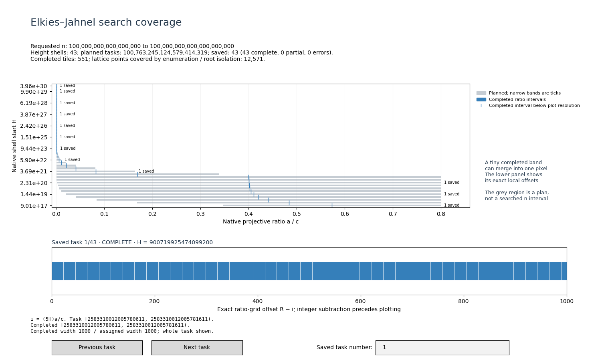
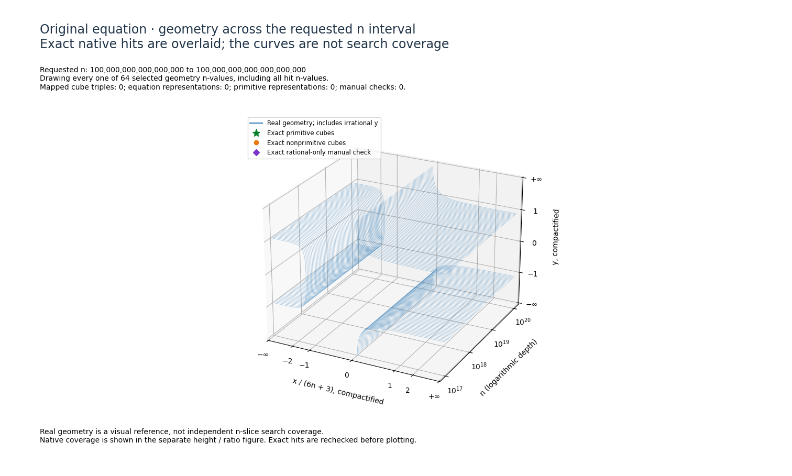
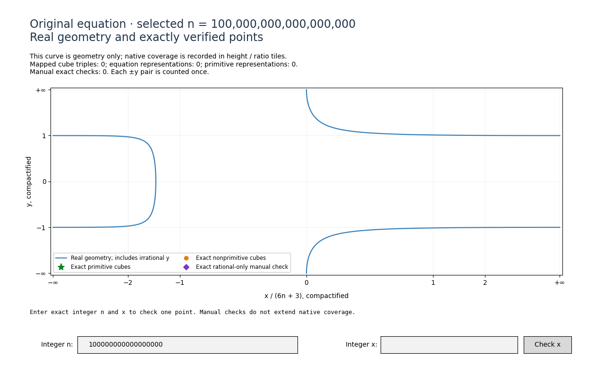

# Computational Experiment #1: a bounded Elkies–Jahnel search with `elkies375`

## Purpose and result

This directory records a **bounded computational experiment** with the
`elkies375` implementation of the projective Elkies–Elsenhans–Jahnel lattice
method. The experiment targets primitive integer cube solutions associated
with

$$
y^2=1+\frac{36n^3+54n^2+27n-58}{x(6n+3+x)^2},
\qquad n,x\in\mathbb Z,\quad y\in\mathbb Q,
$$

over the requested inclusive parameter interval

$$
\boxed{10^{17}\le n\le10^{20}.}
$$

The original equation excludes `x = 0` and `x = -(6n+3)`.

**Observed outcome:** the displayed pilot completed 43 selected height/ratio
tasks, covering 551 tangent tiles and 12,571 lattice points through exact
enumeration or root isolation. It recorded **no primitive target hit**.
The full search over the requested n interval remains unfinished.

This is an experimental computation and visualization record for the
`elkies375` algorithm package. It documents the search configuration, the
finite regions actually processed, the resulting figures, and the limits of
the conclusion. It does not claim a new solution or a proof of nonexistence.

## Files and implementation

| File or directory | Role |
|---|---|
| [run_experiment.py](run_experiment.py) | Launcher with this experiment's exact n interval, primitive target, work budget and display settings |
| [experiment.json](experiment.json) | Machine-readable configuration, reference source identifiers, observed counters and image checksums |
| [validation.json](validation.json) | Results of a fresh launcher run and checks that the shared package and supplied images stayed unchanged |
| [results/search_coverage.png](results/search_coverage.png) | Supplied screenshot of the actual native search coverage |
| [results/real_geometry_3d.png](results/real_geometry_3d.png) | Supplied screenshot of the 3D real geometry across 64 display samples |
| [results/equation_slice_2d.png](results/equation_slice_2d.png) | Supplied screenshot of the real curve at the selected exact n |
| [../elkies375](../elkies375/README.md) | Shared algorithm implementation, used without changes |

The three PNG files are the supplied images, preserved byte for byte under
portable filenames. They have not been regenerated, cropped, recolored or
annotated. Their SHA-256 checksums and original upload names are recorded in
`experiment.json`.

The launcher delegates the computation to the existing sibling `elkies375`
package. It does not contain a modified copy of the lattice kernel. Keep this
`#1` directory beside the complete `elkies375` directory when downloading or
running the experiment.

## 1. Exact configuration of this pilot

| Setting | Value |
|---|---|
| Engine | `elkies` / native `elkies-ej-3d` |
| Minimum n | `100000000000000000` |
| Maximum n | `100000000000000000000` |
| Target | `primitive` integer cube lifts |
| Explicit extra coordinate-height restriction | None; use the full proved planning envelope |
| Ratio-index band width | `1000` |
| Tangent tile scale | `11/2` |
| Maximum native tasks per invocation | `43` |
| Maximum tiles per task attempt | `64` |
| Scheduling | `spread` |
| Task offset | `0` |
| Real-geometry n samples | `64` |
| Initially selected 2D n | `100000000000000000` |

The n interval is a condition on the **sum of the cube coordinates**. Native
tasks are regions in cube-coordinate height and projective ratio; they are
not separate searches at the 64 n-values used to draw the curves.

For a fresh output directory, this configuration chooses one band near the
middle of each of the 43 planned height shells. More precisely, the zero-based
selected band index is `number_of_bands // 2`. Each of the selected bands has
ratio-index width 1,000. The 64-tile allowance is a per-attempt work limit;
all 43 selected bands finished within that allowance in the reference pilot.
It is not a wall-clock runtime guarantee.

## 2. Recorded results and their scope

The visible counters agree with the archived
[large-pilot summary](../elkies375/examples/large-pilot/summary.json) and its
[43 exact task records](../elkies375/examples/large-pilot/tasks/).

| Quantity | Recorded value |
|---|---:|
| Height shells in the full plan | 43 |
| Logical tasks in the full width-1000 plan | 100,763,245,124,579,414,319 |
| Saved / attempted tasks | 43 |
| Completed saved tasks | 43 |
| Partial saved tasks | 0 |
| Error tasks | 0 |
| Distinct shells with completed work | 43 |
| Completed ratio-index units | 43,000 |
| Completed tangent tiles | 551 |
| Lattice points covered by enumeration/root isolation | 12,571 |
| Retained canonical primitive cube triples | 0 |
| Retained equation representations | 0 |
| Manual exact point checks shown | 0 |
| Remaining unstarted logical tasks | 100,763,245,124,579,414,276 |

**The supported conclusion is that no primitive target hit was recorded in
the 43 completed bands.** One completed band in each shell does not complete
the whole shell. The many remaining bands have not been searched by this
pilot. Consequently, the archived summary explicitly records

```json
{
  "full_height_scope": true,
  "complete_target_search_in_n_interval": false,
  "general_rational_y_search_complete": false
}
```

Here `full_height_scope` describes the bounds of the **plan**, not the extent
of finished work. Likewise, a zero count of retained nonprimitive points does
not mean that nonprimitive solutions were exhaustively searched: the selected
target filters for primitive triples.

The lattice-point counter includes intervals handled by the backend's exact
cubic root-isolation step. It is not a count of 12,571 distinct n-values or a
claim that every one of those points was individually evaluated as a cube
triple.

## 3. How to read the coverage figure



The native search uses canonical magnitudes `0 < a <= b < c`. A dyadic height
shell has `H <= c < 2H`, and its projective ratio is `a/c`. The ratio-grid
coordinate is

$$
i=(5H)\frac{a}{c}.
$$

The upper panel shows all 43 height shells in the plan:

- **Grey regions** show permitted, planned ratio ranges.
- **Blue regions** show completed ratio intervals.
- A **thin blue tick** marks a completed interval too narrow to resolve on
  the global ratio scale. Its visible line width is not its mathematical width.

The lower panel expands one saved task using exact integer offsets. In the
supplied screenshot, the selected first task has

```text
H = 900719925474099200
assigned i interval  = [2583310012005780611, 2583310012005781611)
completed i interval = [2583310012005780611, 2583310012005781611)
interval width      = 1000
```

The axis plots `R - i`, where R is this task's upper ratio-index endpoint.
The large origin is subtracted exactly before conversion to plotting
coordinates. The white separators mark completed tangent-tile boundaries.
This panel confirms completion of this one assigned band, not of the entire
height shell or n interval. The interactive Previous/Next controls inspect
the other saved bands.

## 4. Real-geometry visualizations

### 3D geometry across the requested interval



The blue curves draw the real branches of the original equation at 64
selected n-values between the requested endpoints. Both signs of y are
displayed. The depth coordinate is logarithmic in n.

The horizontal variable is the normalized quantity `u = x/(6n+3)`. The
horizontal and vertical drawing coordinates are compactified as

$$
q=\frac{2}{\pi}\arctan(u),\qquad
v=\frac{2}{\pi}\arctan(y).
$$

This puts infinite branches into a finite plotting window; the tick labels
refer to the original normalized x and y values. These are continuous real
curves and include irrational y. They do not establish that plotted positions
have integer x or rational y.

The 64 displayed slices are **geometry anchors**, not 64 completed
integer-solution searches. All exact hit n-values would also be added to the
view; this pilot has no such hits. At these large scales the normalized real
curves are visually very similar, so their appearance alone is not evidence
of arithmetic solution density.

### 2D slice at the selected n



The selected parameter is exactly

$$
n=100000000000000000=10^{17}.
$$

This figure shows its real curve and the interface for exact individual
integer-x checks. No exact hit is plotted. The green star and other symbols
visible in the legend explain the display conventions; they are not found
solutions.

Entering an x performs an individual exact check. It does not extend the
native height/ratio coverage or certify the rest of that n slice.

A useful detail is that `10^17 mod 27 = 19`, outside the necessary integer-cube
classes listed below. Its real curve still exists. This illustrates why a
geometry anchor must not be mistaken for an admissible integer-cube candidate
or an independently searched slice. The integer-lift congruence does not, by
itself, exclude rational-only points with nonintegral cube coordinates.

### Marker conventions

| Marker | Exact meaning |
|---|---|
| Green star | Original equation verified exactly; cube coordinates all integral; cube sum 375; gcd 1 |
| Orange circle | Exact integer cube lift with gcd 5 |
| Purple diamond | Exact rational-only point from an explicit manual check, without an integral cube lift |
| Blue curve | Real geometry, including irrational y |

Each pair `+y,-y` counts as one equation representation; y=0 counts once.
One cube triple can have more than one integer-x representation. Both the
cube-triple count and representation count are zero in these images.

## 5. Connection to primitive solutions of the three-cubes problem

Put

$$
S=6n+3,\qquad T=S+x,\qquad
N=36n^3+54n^2+27n-58=\frac{S^3-375}{6},\qquad t=yT.
$$

Define

$$
(A,B,C)=(-x-t,-x+t,S+2x).
$$

Then

$$
A+B+C=S,\qquad
A^3+B^3+C^3=375-6R,
\quad R=x(t^2-T^2)-N.
$$

An exact solution of the original equation has R=0. Its cube coordinates are
integers exactly when t is an integer. The target in this experiment adds
`gcd(A,B,C)=1`.

Conversely, the native engine's integer cube hits are mapped back by trying
every distinct same-parity pair A,B:

$$
n=\frac{A+B+C-3}{6},\qquad
x=-\frac{A+B}{2},\qquad
t=\frac{B-A}{2},\qquad
y=\frac{t}{6n+3+x}.
$$

The adapter checks the denominator exclusions, the requested n interval,
the original equation, the cube sum and the primitive gcd using exact
arithmetic. Rational y is allowed; accepting a point does not use a
floating-point closeness tolerance.

### Necessary modular conditions

For an integer cube lift,

$$
n\bmod27\in\{2,5,14,20,23\},\qquad
x\equiv1\pmod3,\qquad t\equiv0\pmod3.
$$

These conditions apply to integer cube lifts and are not sufficient to prove
a solution. The native lattice also incorporates the corresponding cube
coordinate restrictions modulo 3. General rational-only y points with
nonintegral t require the separate rational search or individual exact
checks; the primitive lattice pilot does not classify them all.

The derivations are in the shared [equation-adaptation notes](../elkies375/METHOD.md)
and [native lattice method](../elkies375/EJ_METHOD.md).

## 6. Why the complete plan is much larger than this pilot

A bound on n is a bound on the signed coordinate sum `A+B+C`, not on each
individual cube coordinate. The planner derives the following canonical
coordinate-height envelope for the requested interval:

```text
minimum c = 1021448630351589166
maximum c = 6000000000000000000075000000001
```

The maximum is approximately `6 * 10^30`. The upper bound follows from

$$
c\le1+\left\lfloor\sqrt{(S+1)^2+\frac{S^3-375}{6}}\right\rfloor,
$$

rounded down to `c = 1 (mod 3)`; the lower bound uses
`(S+c)^3 <= 4(c^3+375)`. Exact additional inequalities prune impossible ratio
bands. These bounds give a finite, conservative plan for the integer-cube
target. They do not make its entire computation practical in a short run.

The plan's approximately `10^20` logical width-1000 tasks are a partition of
that region, not a count of discovered solutions or an estimate of execution
time. The experiment completes 43 selected tasks from it. Increasing the
number of drawn curves changes the visualization density, not this coverage.

## 7. Run or inspect the experiment in Terminal

### Setup

From the repository root:

```bash
cd "375/Matplotlib/Experiment 2/#1"
python3 -m pip install -r ../elkies375/requirements.txt
```

Use the same Python interpreter for installation and execution. On the Mac
used in the earlier experiments, replace `python3` with
`/usr/local/bin/python3` if that is the interpreter with Matplotlib installed.

An actual native search also needs a C++17 compiler and GMP. Follow the
[shared installation instructions](../elkies375/README.md#1-install-and-run-on-macos).
The viewer can open existing records without compiling or starting a search.

### Inspect the archived result without another search

```bash
python3 run_experiment.py --view-recorded
```

This opens the existing reference campaign and its three Matplotlib windows.
It reads the saved records directly without rewriting their summaries or
checkpoints. The shared implementation and its archived run stay unchanged.

### Run the fixed experiment

```bash
python3 run_experiment.py
```

The launcher uses the settings in Section 1 and writes its new campaign to
`run-output` beside the script. It opens the figures when the bounded search
finishes. The script locates its sibling package relative to its own path, so
it also works when invoked from another current directory.

**An existing output directory is resumed.** To reproduce the initial
43-task selection, choose a new empty output directory:

```bash
python3 run_experiment.py --out ./fresh-run --no-window
```

Repeating this command continues the same campaign and can process additional
bands. Its counters will then exceed those of the archived pilot. Do not
describe a continued campaign as the same initial 43-task computation.

### Print the exact delegated command or create only the plan

```bash
python3 run_experiment.py --show-command
python3 run_experiment.py --plan-only --out ./plan-output
```

`--show-command` prints and exits without writing files. `--plan-only` writes
the exact scope and task plan without running native search tasks. The wrapper
does not expose n-bound, target, or work-budget overrides: those settings
identify this particular experiment.

### Reopen or export a completed local run

```bash
python3 run_experiment.py --plot-only ./fresh-run
python3 run_experiment.py --plot-only ./fresh-run --save-prefix ./exports/run1
```

The export command writes the 2D, 3D and native-coverage PNGs plus plot
metadata, and suppresses interactive windows. The wrapper prevents exports
inside the shared algorithm directory or the campaign being viewed. Export
new figures to a separate directory rather than overwriting this record's
supplied screenshots.

The underlying campaign saves exact task bounds, completed tile intervals,
attempt status, points and source hashes. An interrupted or failed attempt
cannot advance certified coverage. Source or scope mismatches are rejected
instead of silently merging incompatible computations.

## 8. Provenance, reproducibility and interpretation

### Validation of the range-specific launcher

When preparing this directory, the launcher was executed in a fresh output
directory on Linux. The new run reproduced the reference pilot's 43 task
identifiers and scope objects, every completed tile boundary, every per-task
lattice counter, and all point/cube lists. Its aggregate result was again
43 completed bands, 551 tiles, 12,571 covered lattice points and zero primitive
hits. The read-only archived viewer also reproduced the reference plot
metadata. These checks are recorded in [validation.json](validation.json).

After execution and viewing, all 95 tracked files in the shared package
still matched their reference Git blob hashes. The three published PNGs
still matched the supplied attachments. The fresh computation validates the
launcher; its regenerated figures have not replaced the user's screenshots.

### Figure and reference-record provenance

The screenshots in this directory were supplied by the user. Their visible
settings and counts agree with the previously archived large pilot. This
agreement does not, on its own, establish a separate new execution on a
particular machine or date. The attached image files are the visual record;
the following existing files provide the detailed reference computation:

- [Manifest and exact search configuration](../elkies375/examples/large-pilot/manifest.json)
- [Summary and completion flags](../elkies375/examples/large-pilot/summary.json)
- [Task-level exact records](../elkies375/examples/large-pilot/tasks/)
- [Coverage CSV](../elkies375/examples/large-pilot/coverage.csv)
- [The 64 geometry sample values](../elkies375/examples/large-pilot/large-plot-summary.json)
- [Reference run log](../elkies375/examples/large-pilot/run.log)

The reference implementation was read at repository commit
[`f51b5e0`](https://github.com/JAgbanwa/SomethingNew/commit/f51b5e0ea7f468a41f5266cd5fb587e7b0e546bb).
Its `elkies375` tree identifier is
`d9e4a8410e286cc4bd3b20564ea32eb5f0572c0b`. This experiment adds a launcher,
configuration record, documentation and the supplied figures; it makes no
changes to that shared package.

The launcher reproduces the mathematical settings and selected initial task
regions. Window dimensions, fonts, backend, DPI and operating system can
change the pixels in newly exported images, so computational reproducibility
does not mean reproducing a screenshot byte for byte. Existing supplied
images are separately identified by their checksums.

For the relationship to the historical authors' method, see the package's
[source comparison](../elkies375/SOURCE_AUDIT.md), its
[method proof](../elkies375/EJ_METHOD.md), and Huisman's
[methodology discussion](https://arxiv.org/abs/1604.07746). `elkies375` is the
name of this repository's exact implementation; this experiment does not
claim to be an execution of the historical authors' original binary or to
match its performance.
